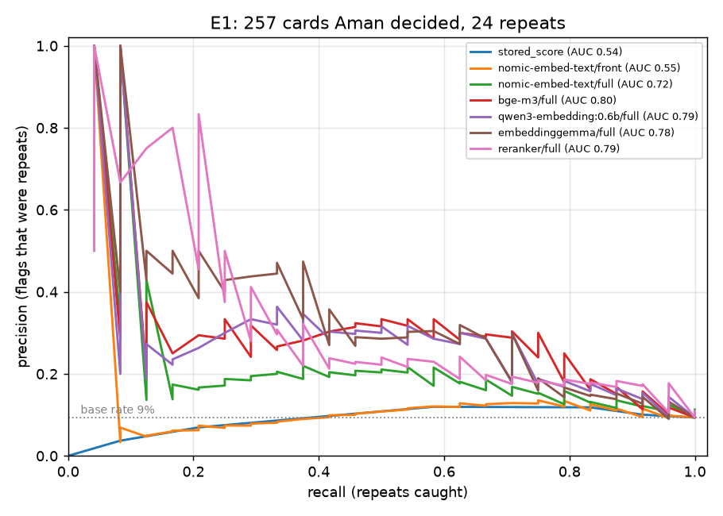

# Card embeddings: findings

From the handoff of 2026-10-29 (a planning chat with Aman). It extends P4's learner model and P3's dedupe.

- **Done:** Phase 0 (recon), the novelty sweep, the E1 retro, and the model check (both below), plus the
  neighbours index and endpoint.
- **Not changed yet:** dedupe and the pipeline.
- **Still to come:** E2 and E5. E3 and E4 wait for data.

Numbers are from the live Ledger and anki-core on 2026-10-29, read-only.

## The short version

- **Cards are already embedded.** Dedupe has embedded every note since 2026-09-25: `nomic-embed-text` (768-d) on
  Helios's Ollama, cached in the Ledger's `note_embedding`. The leech doctor uses the same index for neighbours. But it
  embeds **only the first field**, with nomic's `clustering:` prefix. That's the wrong text for search, and as the
  next point shows, the wrong text for dedupe too.
- **E1 has labels already, and they say the current guard is miscalibrated.** Aman has decided 287 cards that dedupe
  scored: 226 flagged ones and 61 held "duplicates".
  - In the flag band (0.88–0.92), the score barely separates the cards he rejected from the ones he kept.
  - In the duplicate band (≥ 0.92), he kept **all 61** held cards.
  - The misses have clear causes: minimal pairs (±1σ vs ±2σ, n_e→0 vs T_e→0, field vs potential on a ring's axis),
    and IPA glyphs that all score 1.00 against one Hindi letter.
  - Outside review, the lecture pipeline drops anything ≥ 0.92 and doesn't store what it dropped, so we can't count
    how many valid sibling cards it has lost.
- **E3 and E4 don't have the data yet.** The review history is far too small to train on (KARL used 123k logs
  from 543 learners). These two need to wait for data, with a trigger to re-check.
- **E2 is feasible but small.** Only one exam's problems are in `exam_material` so far. The known outcomes are the
  graded debriefs.
- **The novelty sweep found no closed loop.** Nobody joins card embeddings to generation, exam coverage, and tutoring.
  The pieces exist separately (below).

## Phase 0: recon

### 1. How the collection is read; where FSRS state comes from

Only through **anki-core** (vendored `raslab/anki-sync-mcp`): a headless copy of the collection, Anki 26.5 rslib,
syncing with `helios-anki-sync`. It's reached over MCP, and only `anki/core_client.py` talks to it, through its
allowlist. There's no AnkiConnect and no direct SQLite, so invariant 1 holds.

| What | Tool | Fields |
|---|---|---|
| FSRS state | `anki_cards_get` with `include_sections: ["fsrs", "review_summary"]` | `memory_state.stability`, `memory_state.difficulty`, `retrievability` (computed by Anki), `desired_retention` (0.85), the 21 FSRS-6 parameters |
| Lapses, reps, queue | `anki_cards_get` | `scheduling` |
| Revlog | `anki_reviews_list` | paged; by card or by search |

`learner.card_view` already turns all of this into the per-card stats `search_cards` returns.

For the offline experiments (E3–E5), paging the revlog over MCP is fine. A `.colpkg` copy read the way
`scripts/audit.py` reads it would also work, and touches nothing live.

### 2. The vault's embedding stack, and whether cards can share it

**Where it lives.** It's `semantic_search` in the homelab's `mcp/rag.py`, running in `helios-mcp`:
- embeddings: `nomic-embed-text`, 768-d, from `helios-ollama`;
- store: `sqlite-vec` at `/vec/vectors.db`;
- retrieval: **hybrid**. Dense KNN plus FTS5/BM25, fused by reciprocal rank fusion (k = 60), then reranked by
  `helios-reranker` (TEI serving `BAAI/bge-reranker-v2-m3` on the GPU).

**What cards can share.**
- **The model:** they already do. Dedupe calls the same Ollama with the same model.
- **The reranker:** yes. It's an HTTP service, and the multilingual cross-encoder is exactly what minimal pairs need
  (E1).
- **The store:** no. Its exposure rules (vault privacy tiers) belong to the vault, and it lives in the homelab stack,
  which Aman commits himself. Card vectors belong in the Ledger next to `note_embedding`.
- **Pattern, not code:** copy rag.py's hybrid + RRF + rerank design.

**sqlite-vec isn't needed at this size.** 3.7k × 768 float32 is 11 MB. A numpy brute-force scan takes well under a
millisecond, which is what `dedupe.classify` already does.

### 3. Collection shape

| | Cards |
|---|---|
| Total | 3,549 |
| M-Basic | 2,922 |
| M-Cloze | 192 (5%) |
| M-IPA | 186 |
| M-Error | 104 |
| M-Sign | 96 |
| M-Estimate | 49 |
| Has MathJax `\(` | 2,612 (74%) |
| Has an image | 25 |
| `lang::*` tagged | 190 |
| `course::*` tagged | 1,733 |
| `src::legacy` | 1,385 |

What this means for embeddings:
- **LaTeX is the main case, not an edge case.** Three quarters of cards carry MathJax.
- **Two note types are poor fits for text embedding.** M-IPA (a glyph) and M-Sign (a video) are 8% of cards. Their
  embeddings should come from the answer and tags, or they should be left out.
- **Cloze is small.** It's worth handling correctly, but it isn't the bulk.
- **Tags follow a fixed scheme:**
  - `course::<code>::lNN-<slug>` for lectures (lecture tags plus `::examN` on legacy cards);
  - `topic::` with the first one as home (canon 22);
  - `principle::`, `mode::`, `src::`.
  - All come from `config/topics.yaml`. Tags and course are cheap context to add to the embedded text.
- **The cache needs pruning.** `note_embedding` has 3,703 rows, more than there are notes. Drafts are cached under
  negative ids, and deleted notes are never pruned. It's harmless, but it should be cleaned when the cache gains a
  second representation.

### 4. How `propose_cards` flows, and where a check slots in

1. `mnemosyne_propose_cards` calls the api's `/inbox` with checks on.
2. The api calls `pipeline.check_and_propose`, which runs:
   1. the verify gate;
   2. `dedupe.existing_notes`, which pages `anki_notes_search` for every note's first field, plus open drafts under
      negative ids;
   3. `dedupe.index`, which embeds only what's new or changed and caches it;
   4. `dedupe.classify`, which labels each card: **duplicate** at ≥ 0.92, **flag** at 0.88–0.92, **same-batch
      duplicate** at ≥ 0.97;
   5. `merge.targets` (cross-course merges and merge-ups, canon 22);
   6. `policy`.
3. MCP and session cards are always held. Lecture cards that dedupe calls duplicates are dropped. Only their count
   reaches the log, through `Outcome.dropped`; it isn't persisted.

**The slot already exists: `dedupe.classify`.** E1 changes what it embeds, its thresholds (possibly per note type),
and adds a rerank step for the uncertain band. It doesn't add a new stage. The leech doctor (`schedule/leech.py`)
reads the same index, so it benefits too.

### 5. Exam artifacts available to embed

| Ledger table | Rows | What's there |
|---|---|---|
| `exam_material` | 1 | A review with problems, summaries, lectures, topics |
| `exam` | | His exams, with dates |
| `exam_map` | | |
| `graded_work` / `mistake` / `mistake_attempt` | | Returned work with every lost point: the known outcomes |
| `probe` | | Whether a held card can be used, not just recalled |
| `question` | | Aman's questions from slides and sessions |

Past PHYS 207/221 practice exams aren't in `exam_material`. Validating E2 against them would need Aman to send them
through Paperless. Until then, the graded debriefs are the retrospective check, and MATH 309 Exam II can be the
prospective one.

### 6. Hardware budget

The Obelisk has an RTX 2080 (8 GB; 5.8 GB was in use at the time of the check, by an Ollama LLM and the reranker),
12 cores, and 15 GB of RAM (6 GB free).

- **Compute isn't the constraint.** The collection is ~3.5k short texts. nomic embeds all of it in seconds, and even a
  0.6B model would take about a minute for a full re-embed. Incremental refresh is already lazy, run on each dedupe
  call.
- **VRAM is the constraint.** A second embedding model has to coexist with qwen and the reranker, and Ollama swaps
  models in and out. A 300–600M model is a few hundred MB to ~1.2 GB.
- **Ollama has:** `nomic-embed-text`, `qwen3:8b`, `qwen2.5:14b`, `qwen2.5:7b`. No alternative embedding model is
  pulled yet.

No new scheduled job is needed. The Ledger cache refreshes when dedupe runs, and anything batch can ride the existing
04:15 run, which already reads the collection (invariant 8).

## E1 already has labels

Every held card keeps its dedupe score in `card_draft.review_reason`, and Aman's decision in `status` and
`decision_note`.

**Flag band (0.88–0.92), with scores:**

| Score | Rejected | Kept (written) | Merged | Rejected share |
|---|---|---|---|---|
| 0.88 | 3 | 35 | | 8% |
| 0.89 | 3 | 51 | | 6% |
| 0.90 | 9 | 47 | | 16% |
| 0.91 | 11 | 37 | 1 | 22% |
| 0.92 (rounded) | 1 | 12 | 2 | 7% |

There are 12 more flags scored 0.0, from when Ollama was down: 5 rejected, 7 kept.

**Duplicate band (≥ 0.92), held:** 59 kept and 2 merged up, out of 61. **None rejected.** 29 of them scored 1.00.

**Samples of kept "duplicates":**
- six IPA glyphs (ʙ ɮ ʍ ɱ ɢ ɭ), each 1.00 against the Hindi letter घ;
- "within ±2σ" vs "±1σ" (0.98), and "±3σ" vs "±2σ" (0.98);
- ∇×(f**F**) vs ∇×(∇×**F**) (0.98);
- "Debye length as n_e→0" vs "as T_e→0" (0.97);
- transient vs secular equilibrium (0.94);
- field vs potential on a ring's axis (0.93);
- "the only interaction that violates parity" vs "the weak interaction" (1.00): a reverse pair.

What this says:
1. The score alone has almost no precision. Only 15% of flags were real duplicates, and the rejected share hardly
   rises with the score.
2. Front-only embeddings miss the one token that makes a fact distinct. Canon 15 *asks* for those minimal pairs, and
   canon 17 asks for the limit cards. The back, or a cross-encoder, should separate most of them.
3. nomic collapses rare Unicode, so every IPA glyph looks the same.
4. In the lecture pipeline, the ≥ 0.92 auto-drop is probably losing valid siblings, and nothing records them.

**Recall data exists too.** 57 rejections carry a "duplicate" note. Some came during the Ollama outage, and some came
from the 2026-09-29 audit's cross-lecture merges. The ones dedupe had called "new" are its misses.

So E1's first pass needs no hand labeling. Re-score these ~290 decided pairs plus the ~57 misses under each
candidate:
- front only vs front + back + tags;
- nomic `clustering:` vs the `search_*` prefixes;
- two alternative models;
- bge-reranker-v2-m3 on the pair.

Then plot precision and recall by threshold, per note type. Only the ambiguous leftovers go to Aman.

## Novelty sweep

These are from searches and abstracts. I haven't read the full papers; numbers marked as reported are unverified.

| Work | What it does | Relevance |
|---|---|---|
| **KARL / KAR³L** (Shu et al., EMNLP 2024) | BERT embeddings plus retrieval of similar studied cards plus FSRS-style features. Beats FSRS v4 on AUC and calibration. 123k logs, 543 learners. | E4's template; it needs far more data than Aman has. |
| **LECTOR** (Zhao, arXiv 2508.03275, Aug 2025) | An LLM scores semantic similarity of concept pairs into an *interference matrix*, which spreads confusable items apart. Exam vocabulary; evaluated **by simulation only**. Reported 90.2% vs 88.4% success. | The closest prior art to E3. It assumes interference rather than measuring it, which E3 would test. |
| **srs-benchmark RWKV model** (open-spaced-repetition) | Takes sibling cards, deck and preset hierarchy, and the full multi-card history. **Not card content.** | The FSRS org's closest step. Issue #129 proposes sibling reviews as pseudoreviews. |
| **fsrs4anki-helper #371** | Dispersing siblings makes "cousins" (related cards on different notes) land together. | The scheduling side of E3. Out of scope: we don't touch scheduling. |
| **AnnA** | Embedding cache keyed on note modified time; keeps similar cards off the same day. | Its cache idea is already in `note_embedding`, keyed on text hash. |
| **AnkiVec**, **Linked Notes** | `vec:` search; opening the lecture page that matches a card. | Search only. |
| **Anki-MCP (acm)**, **Obsidianki** | Ollama kNN dedupe at generation time (Obsidianki defaults to 0.7). | Same as today's dedupe. None of them report calibration against real decisions. |
| A "flashcards" skill (skillsmp, practitioner) | Maps cards to a source's atomic facts: covered, partial, or missing. | E2-shaped against lectures, not exams, with no evaluation. |
| Giacomo Randazzo, "Content-aware SR" + HN thread | Related-card histories; difficulty from text before any reviews. An FSRS developer confirms FSRS is content- and deck-agnostic. | Motivation. |

Nothing from `open-spaced-repetition` adds content-aware modelling as of this sweep. I found no evaluated system that
closes the loop between card embeddings and generation, exam coverage, or tutoring. Every stage exists separately.
That keeps mnemosyne's angle a hypothesis worth testing, as the handoff says.

Sources:
- [KARL](https://arxiv.org/abs/2402.12291)
- [LECTOR](https://arxiv.org/abs/2508.03275)
- [srs-benchmark](https://github.com/open-spaced-repetition/srs-benchmark) and
  [issue #129](https://github.com/open-spaced-repetition/srs-benchmark/issues/129)
- [fsrs4anki-helper #371](https://github.com/open-spaced-repetition/fsrs4anki-helper/issues/371)
- [AnnA](https://github.com/thiswillbeyourgithub/AnnA_Anki_neuronal_Appendix)
- [AnkiVec](https://samanklesaria.github.io/posts/ankivec/ankivec.html)
- [Linked Notes](https://forums.ankiweb.net/t/i-built-an-anki-add-on-that-automatically-pulls-up-the-lecture-page-your-card-came-from/69327)
- [Obsidianki](https://github.com/ccmdi/obsidianki)
- [Content-aware SR](https://www.giacomoran.com/blog/content-aware-sr/) and its
  [HN thread](https://news.ycombinator.com/item?id=44790422)
- [Memdora](https://arxiv.org/abs/2607.25096) (cites KARL; builds on FSRS-6)

## E1 retro and the model check (2026-10-29)

**How to re-run it:** `scripts/embed_eval.py`, in two steps (`collect`, then `score`), inside the api container.
Card text stays in the container's `/tmp`. The numbers, without card text, are in
[`embeddings/results-2026-10-29.json`](embeddings/results-2026-10-29.json).

**The labels:** 287 decided cards.
- 12 were scored while Ollama was down, so they're out.
- 8 were rejected for other reasons, so they're out.
- For 10, the matched note couldn't be recovered from the stored text.
- That leaves **257 pairs: 24 repeats** (rejected as a duplicate, or merged) **and 233 kept**.

**The texts:** each pair was scored three ways:
- `front`: the first field, as dedupe does today;
- `full`: `neighbors.note_text`, which is prompt + answer + extra fields + topic and course tags;
- `texwords`: `full` with TeX read as words.

### How well each scorer separates repeats from kept cards (AUC, 95% bootstrap CI)

| Scorer | front | full | texwords |
|---|---|---|---|
| Today's stored dedupe score | 0.54 (0.45–0.63) | | |
| nomic-embed-text | 0.55 (0.46–0.65) | 0.72 (0.61–0.81) | 0.73 (0.62–0.82) |
| bge-m3 | 0.72 (0.62–0.82) | **0.80 (0.69–0.89)** | 0.79 (0.69–0.88) |
| qwen3-embedding:0.6b | 0.73 (0.63–0.83) | 0.79 (0.68–0.88) | 0.80 (0.69–0.88) |
| embeddinggemma | 0.70 (0.59–0.79) | 0.78 (0.67–0.88) | 0.79 (0.68–0.89) |
| bge-reranker-v2-m3 (cross-encoder) | 0.67 (0.54–0.79) | 0.79 (0.69–0.87) | |

- **Today's guard is at chance on the cases it surfaces.** That's within the band it flags; true duplicates scoring
  below 0.88 never reached Aman, so recall below the band is unmeasured.
- **Embedding the whole idea is the big win.** It takes nomic from 0.55 to 0.72. The better models add about another
  0.07, with overlapping CIs. TeX-as-words makes no reliable difference.
- **No scorer can auto-reject.** At 90% precision, every one catches 4–12% of repeats. The best F1 points sit at
  about 30–35% precision and 60–75% recall.
- **The answer for this band is to rank and show, not drop.** Similarity can order the review and show the matched
  card, while Aman (or Claude, for obvious repeats) decides.
- **There's no basis yet for per-type thresholds.** All 24 repeats are M-Basic, M-Error, or M-Estimate. The 44 IPA
  pairs and 3 Sign pairs were all kept.

### Retrieval (69 queries; recall@5 / MRR over all 3,240 notes)

| Model | front | full | full + reranker |
|---|---|---|---|
| nomic-embed-text | 0.17 / 0.11 | 0.91 / 0.83 | **0.94 / 0.89** |
| bge-m3 | 0.22 / 0.16 | 0.91 / 0.82 | 0.94 / 0.90 |
| qwen3-embedding:0.6b | 0.30 / 0.24 | 0.91 / 0.74 | 0.94 / 0.89 |
| embeddinggemma | 0.35 / 0.25 | 0.93 / 0.78 | 0.94 / 0.89 |

**The query set:**
- 8 of Aman's own questions that became cards;
- 25 formula answers;
- 12 each of IPA descriptions, ASL notes, and error fixes.

Two caveats about it:
- **Most of these queries are easy.** The formula, IPA, ASL, and error queries are a card's own answer, which `full`
  contains, so they test "find the card from what it says" and are lexically easy.
- **His own questions are the honest test, and there are only 8.** Every model gets 4–5 of them.

What the numbers show:
- **Front-only is useless for search.** IPA and ASL queries score 0, since a glyph or a video is all it sees.
- **With `full` text and the reranker, the models tie.**

**Hardware decides the model.** `qwen2.5:7b` is pinned in the GPU's memory "Forever" (Hyperion's), which leaves
about 1.5 GB. bge-m3 (1.3 GB loaded) ran 72% on CPU during the eval. nomic (274 MB) fits beside it.

**Live check:** "how far an electric charge's influence reaches in a plasma before it's screened out" returns the
Debye cards first, though the query shares no word with them. "trilled sound made with both lips" returns ʙ first.
Each search takes about 1 s, reranker included.

### What's built

- **Index:** the `note_vector` table (migration 0026). One row per note × model × text, keyed on the text hash. It
  holds the embedded text (which the reranker reads back) and the note's card ids. The first build embedded 3,240
  notes.
- **Code:** `neighbors.py`.
  - `refresh` brings the index up to date; it's idempotent and reads the collection only.
  - `search` finds the dense neighbours, fuses them by RRF with Anki's word search, then reranks the top 25. It
    returns `learner.search`'s shape plus `similarity`.
- **Endpoint:** `GET /learner/neighbors?q=…|card_id=…&k=`.
- **Rebuild:** `POST /neighbors/refresh`, which needs the approve token.
- **04:15:** a `neighbors_index` step.
- **The flag:** everything is behind `embeddings.neighbors` in `config/llm.yaml`, which is **off**. The endpoint
  answers 404 and 04:15 skips the index.
- **The MCP tool:** `ops/helios-hooks/patch_helios_neighbors.py` adds `mnemosyne_neighbors`. It's written but not
  applied.
- **Dedupe:** unchanged.

### Recommendations from E1

1. **Search:** nomic + `full` + the reranker. It ties the bigger models and stays on the GPU.
2. **Dedupe:** done the same day; see below.

### Dedupe on the whole card (2026-10-29, Aman's call)

**Calibration.** The 600 most recent written cards were re-scored with nomic on the whole card, each against the
notes that existed before it (same-batch siblings left out). These are cards Aman kept, so any share above a
threshold is the false-positive load:

| Whole-card score | Share of lecture cards at or above it |
|---|---|
| ≥ 0.88 | 21.8% |
| ≥ 0.90 | 10.5% |
| ≥ 0.91 | 5.9% |
| ≥ 0.92 | 3.8% |
| ≥ 0.93 | 2.1% |
| ≥ 0.95 | 0% |

For comparison, the old first-field flag held about 11% of cards.

**What changed:**
- **What's compared:** the whole card (`neighbors.note_text`), for new cards, notes, and waiting drafts.
- **Where note fields come from:** the Ledger's `note_text` cache (migration 0027). Only new notes and those Anki's
  `edited:n` search returns are re-read; every note is re-read weekly.
- **Thresholds:**
  - `FLAG` = 0.90: held, as before. That's about 10% of lecture cards, and it caught 71% of E1's repeats.
  - `DUPLICATE` = 0.93: dropped. That's about 2% of lecture cards; its precision is low, so drops are audited.
  - `SAME_BATCH` stays at 0.97.
- **Drops are reviewed weekly, not as they happen** (Aman: "make a list of what's been dropped and evaluate during
  audits"). Every card dedupe checks is recorded in `dedupe_match`, with its kind, score, nearest note, and model. A
  dropped card keeps its whole payload. `mnemosyne_weekly_audit` gains a `dedupe` section: what was checked, the
  week's drops with what each matched, and what Aman did with flagged cards. The `mnemosyne-weekly` skill restores a
  wrong drop by proposing its payload again.
- **Chat and session proposals:** still held with their match, as before.
- **The fallback** (Ollama down): matches the prompt exactly and flags everything else, as before.
- **The leech doctor:** its "similar notes" use the whole-card text too.

**What to watch:**
- the weekly share of drops that weren't repeats (this decides `DUPLICATE`);
- `flagged_outcomes` (this decides `FLAG`).

Every new match is labeled by the note it hit, so the next E1 run needs no text matching.

## Proposed plan, revised by recon

1. **Index (Phase 1).**
   - **Storage:** a second representation in the Ledger (migration). For each note: front + back + tags + course and
     lecture, plus the cloze-deleted fact for cloze notes. IPA and Sign notes use their answer and tags. Each row is
     keyed on note, representation, model, and text hash, and stale rows get pruned. The numpy scan stays; no
     sqlite-vec.
   - **Search:** a hybrid of dense, Anki's lexical search, and RRF, then a bge-reranker pass.
   - **Interface:** a **new** tool, `mnemosyne_neighbors(card_id | text, k)`, with the same per-card stats as
     `search_cards`. It goes behind a flag, and the existing tool's shape stays as it is.
2. **E1 retro on the existing labels**, plus the model check (§6 of the handoff). Both use the same ~290 pairs, plus
   ~50 retrieval queries (concept phrasing, a problem statement, LaTeX, IPA, Spanish and Hindi). Candidates:
   `bge-m3` (multilingual; the reranker's family), `qwen3-embedding:0.6b`, `embeddinggemma`, against nomic.
3. **E2** on the MATH 309 review now, and on the graded debriefs retrospectively.
4. **E5** as a descriptive map: clusters coloured by retrievability and Again rate, with mistakes overlaid.
   Statistical claims about lapse concentration wait for data.
5. **E3 and E4 deferred.** Re-check monthly in the weekly audit. Run them once there are about 300 lapsed cards or
   about 15k reviews, whichever comes first.
   - Meanwhile, the richer failure signals are Again ratings during learning, probe misses, and mistakes.

## Didn't work, or can't yet

- E3 and E4 on today's revlog (see above).
- Measuring what the lecture pipeline's auto-drop has lost: the drops aren't persisted.
- **A safe auto-reject threshold:** none exists on these labels, for any model (E1).
- **TeX-as-words normalization:** no reliable gain (E1).
- **Telling models apart for search:** after reranking, all four tie at 0.94 recall@5.
- **Natural queries:** only 8 of Aman's questions became cards that could be matched, so the honest part of the
  retrieval test is small.

## Moving to a better model (runbook)

**Today:**
- **Search:** nomic-embed-text (274 MB) plus bge-reranker-v2-m3.
- **Dedupe:** nomic.
- **Vault:** `rag.py` uses nomic too, so cards and notes share one space (`docs/learner-graph.md`).
- **The binding limit is GPU memory, not compute.** The RTX 2080 has 8 GB, and Hyperion keeps `qwen2.5:7b` loaded
  "Forever" (4.6 GB). During the eval, bge-m3 ran 72% on CPU.

### What a swap touches, in order

1. **Search** (`embeddings.model` in `config/llm.yaml`).
   - `note_vector` is keyed on the model, so the new model's rows build beside the old ones: run
     `POST /neighbors/refresh` before flipping the config.
   - Add the model to `scripts/embed_eval.py`'s `MODELS` and re-run it, for recall@5 and MRR against today's numbers.
   - A new model family needs its prompts in `neighbors.PROMPTS`.
   - No thresholds are involved, so nothing to recalibrate.
2. **Dedupe** (`embeddings.dedupe_model`).
   - The cache is keyed on the model, so it re-embeds by itself on the next check.
   - **The thresholds don't carry over.** `FLAG` and `DUPLICATE` in `verify/dedupe.py` are nomic's. bge-m3's
     best-F1 point sat at 0.80 where nomic's was at 0.92.
   - Recalibrate in the same change: E1 on `dedupe_match`'s labels (Aman's decisions, recorded since 2026-10-29),
     plus the hold-rate table above. Then move both numbers.
3. **The vault** (homelab `rag.py`: `EMBED_MODEL`, and `DIM = 768`, which is hard-coded).
   - Run `reindex --full`. The new dimension needs a fresh `vec0` table.
   - This is a homelab change Aman commits. Do it together with step 1, or the learner graph's shared space splits.
4. **The reranker** (TEI `--model-id`). It's independent of the rest; a bigger reranker is probably the most search
   quality per GB.

The compute is minutes: 3k notes and the vault. The work is one session, plus Aman's OK on the homelab change.

### What to expect

- **Dedupe:** every 0.6B-class model beat nomic on E1 (AUC about 0.79–0.80 vs 0.72), which means fewer wrong drops
  at the same hold rate. That's the clearest gain.
- **Search:** with the reranker, all four models tied at 0.94 recall@5. Gains would show on harder queries:
  cross-lingual, math-heavy, and his own questions, of which there are only 8 so far.
- **Larger embedders (4B–8B) are untested on his data.** Re-run the eval before believing a leaderboard.
- **More GPU memory also lets local models do the learner graph's later phases.** Today, connect questions are worded
  in Claude sessions, and a G4 adapter would train beside the LLM instead of on CPU.

### What counts as better hardware

- **GPU memory first.**
  - **16 GB** fits a 0.6–4B embedder and a reranker beside a 7B LLM.
  - **24 GB** (a used RTX 3090 is the usual homelab pick) also fits `qwen2.5:14b` entirely on the GPU.
  - A newer generation than the 2080's Turing also gains bf16 and flash attention, which TEI and newer models
    expect.
- **RAM second.** 15 GB with 6 free is tight for ~25 containers. 32 GB or more gives headroom, and room to spill to
  CPU.
- **The CPU barely matters.**
- **A no-cost option:** stop pinning `qwen2.5:7b`. That frees about 4.6 GB, at the price of Hyperion's ~60 s cold
  load. Hyperion owns that decision.
